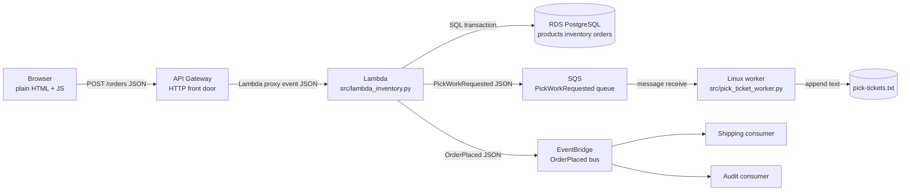
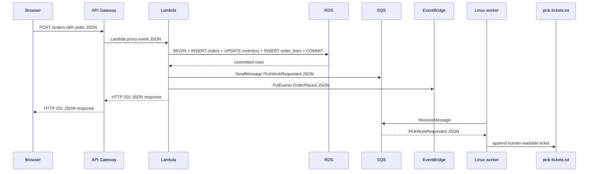

# TinyWMS end-to-end walkthrough

## Purpose
This document traces one TinyWMS warehouse order through the final system from browser input to the final appended pick ticket.

The goal is not to praise cloud services. The goal is to help students answer the same practical questions they used earlier in the course:
- What code is running?
- Where is it running?
- What JSON crosses this boundary?
- What persistent state changes here?
- What can fail here?
- Who is responsible for operating it?

A useful mental model is: the final architecture is still made of the same ideas students saw on Raspberry Pi Linux, just distributed across more boundaries.

## One-order scenario
We will trace this order request:

```json
{
  "customer": "Example School Store",
  "lines": [
    {
      "sku": "SKU-1001",
      "quantity": 1
    }
  ]
}
```

The expected end state is:
- RDS inventory for `SKU-1001` is decremented by 1
- one order row and one order-line row are committed
- one `PickWorkRequested` JSON message is sent to SQS
- one `OrderPlaced` JSON event is sent to EventBridge
- one human-readable ticket is appended to `pick-tickets.txt` by the Linux worker

## Big-picture Mermaid diagram


## Sequence Mermaid diagram


## Step 1: Browser builds the order request
### Executing code
- `src/web/index.html`
- `src/web/app.js`

### Compute environment
- student browser on a laptop, desktop, Raspberry Pi desktop, or another client machine

### Input JSON
- none yet; the student types into form fields

### Output JSON
The browser turns form fields into this request body:

```json
{
  "customer": "Example School Store",
  "lines": [
    {
      "sku": "SKU-1001",
      "quantity": 1
    }
  ]
}
```

### Network boundary
- browser will send HTTP `POST /orders`
- request `Content-Type: application/json`
- request body is the order JSON above

### Persistent state
- none yet; this is still client-side state in the page

### Possible failure
- JavaScript could build invalid JSON
- student could leave fields blank or enter quantity `0`
- browser could point at the wrong base URL

### Responsible operator/provider
- student or instructor controls the browser page and configured base URL
- browser vendor provides the runtime

### Raspberry Pi/Linux connection
This is still the same visible client-side behavior students saw earlier: plain text inputs become visible JSON. No framework is hiding the request body.

## Step 2: Browser sends HTTP to API Gateway
### Executing code
- browser `fetch()` call in `src/web/app.js`
- API Gateway route created by `deploy/aws/template.json`

### Compute environment
- browser on the client machine
- API Gateway in AWS

### Input JSON
```json
{
  "customer": "Example School Store",
  "lines": [
    {
      "sku": "SKU-1001",
      "quantity": 1
    }
  ]
}
```

### Output JSON
API Gateway does not keep the HTTP request body as the only object. It wraps the request into a Lambda proxy event. A representative event looks like:

```json
{
  "httpMethod": "POST",
  "path": "/orders",
  "headers": {
    "content-type": "application/json",
    "accept": "application/json"
  },
  "queryStringParameters": null,
  "body": "{\n  \"customer\": \"Example School Store\",\n  \"lines\": [\n    {\n      \"sku\": \"SKU-1001\",\n      \"quantity\": 1\n    }\n  ]\n}",
  "isBase64Encoded": false
}
```

### Network boundary
- HTTPS from browser to API Gateway
- HTTP concepts still matter: method, path, headers, status, body

### Persistent state
- API Gateway does not become system-of-record storage for the order

### Possible failure
- DNS or TLS problems
- wrong deployed URL or stage name
- missing route for `POST /orders`
- API Gateway can return 4xx or 5xx before Lambda even runs

### Responsible operator/provider
- AWS operates API Gateway infrastructure
- repository operator owns route configuration and deployment

### Raspberry Pi/Linux connection
Students already learned that an HTTP request has a method, path, headers, and body. API Gateway adds infrastructure, but it does not erase those basics.

## Step 3: API Gateway invokes Lambda
### Executing code
- `src/lambda_inventory.py`
- `src/order_service.py`

### Compute environment
- AWS Lambda runtime

### Input JSON
The Lambda handler receives the proxy event JSON shown above.

### Output JSON
Lambda eventually returns an HTTP-style response object such as:

```json
{
  "statusCode": 201,
  "headers": {
    "Content-Type": "application/json"
  },
  "isBase64Encoded": false,
  "body": "{\n  \"customer\": \"Example School Store\",\n  \"lines\": [\n    {\n      \"quantity\": 1,\n      \"sku\": \"SKU-1001\"\n    }\n  ],\n  \"orderId\": 42,\n  \"status\": \"created\"\n}"
}
```

### Network boundary
- managed AWS service-to-service invocation boundary
- students should still think of it as JSON in and JSON out

### Persistent state
- none yet at handler entry
- Lambda is compute, not durable storage

### Possible failure
- missing environment variables like `TINYWMS_DB_HOST`
- invalid JSON in `event["body"]`
- unsupported route or method
- unhandled exceptions become 500-class failures

### Responsible operator/provider
- AWS operates Lambda runtime and scaling
- repository operator owns handler code, environment variables, IAM role, and deployment package

### Raspberry Pi/Linux connection
Lambda is still just code running in a process-like execution environment with environment variables, stdout/stderr logs, and failure modes. The operator just manages fewer host details directly.

## Step 4: Lambda validates the order request
### Executing code
- `parse_order_event_body()` in `src/order_service.py`
- `validate_order()` in `src/order_service.py`

### Compute environment
- same Lambda invocation

### Input JSON
```json
{
  "customer": "Example School Store",
  "lines": [
    {
      "sku": "SKU-1001",
      "quantity": 1
    }
  ]
}
```

### Output JSON
If valid, the order continues internally as a Python dictionary with the same meaning.

If invalid, Lambda returns visible error JSON such as:

```json
{
  "error": "invalid order request",
  "details": [
    "lines[0].quantity must be a positive integer"
  ]
}
```

### Network boundary
- none yet; still inside one Lambda invocation

### Persistent state
- none; validation happens before DB commit

### Possible failure
- malformed JSON string in the proxy event body
- missing `customer`
- empty `lines`
- negative or zero quantity

### Responsible operator/provider
- repository operator owns validation rules
- client is responsible for sending a valid contract

### Raspberry Pi/Linux connection
This is like CLI validation from early stages: inspect a JSON document, reject invalid shape visibly, and avoid hidden magic.

## Step 5: Lambda writes the RDS transaction
### Executing code
- `create_order_in_rds()` in `src/rds_inventory.py`
- `create_order_with_connection()` in `src/rds_inventory.py`

### Compute environment
- Lambda execution environment talking to Amazon RDS PostgreSQL over the network

### Input JSON
The validated order object still means:

```json
{
  "customer": "Example School Store",
  "lines": [
    {
      "sku": "SKU-1001",
      "quantity": 1
    }
  ]
}
```

### Output JSON
After commit, Lambda has an order result object like:

```json
{
  "orderId": 42,
  "customer": "Example School Store",
  "status": "created",
  "lines": [
    {
      "sku": "SKU-1001",
      "quantity": 1
    }
  ]
}
```

### Network boundary
- TCP connection from Lambda in the VPC to RDS PostgreSQL
- this is not a JSON boundary; it is a SQL boundary

### Persistent state
RDS becomes the source of truth here:
- `orders` gets one new row
- `order_lines` gets one or more rows
- `inventory_locations.quantity` is decremented if enough stock exists

### SQL shape
The visible teaching idea is:
- insert order row
- conditionally decrement inventory with a quantity check
- insert order lines
- commit only if all lines succeed

### Possible failure
- database credentials wrong
- security groups or subnets block connectivity
- schema missing because bootstrap SQL was not run
- insufficient inventory causes rollback
- transaction error causes rollback

### Responsible operator/provider
- AWS operates the RDS service runtime
- repository operator/student still owns schema bootstrap, credentials, network configuration, and application SQL behavior

### Raspberry Pi/Linux connection
Earlier students watched files change on Linux. Now the durable state is a database instead of a JSON file, but the core question is the same: where is the data, when does it become durable, and what happens if the write fails?

## Step 6: Lambda returns HTTP success or failure JSON
### Executing code
- `build_response()` in `src/lambda_inventory.py`
- `build_response()` in `src/order_service.py`

### Compute environment
- same Lambda invocation

### Input JSON
- success path uses the committed order result JSON
- failure path uses an error object

### Output JSON
Successful response body:

```json
{
  "orderId": 42,
  "customer": "Example School Store",
  "status": "created",
  "lines": [
    {
      "sku": "SKU-1001",
      "quantity": 1
    }
  ]
}
```

Insufficient inventory response body:

```json
{
  "error": "insufficient inventory",
  "sku": "SKU-1001",
  "requested": 1,
  "available": 0
}
```

### Network boundary
- Lambda response object goes back through API Gateway to the browser as HTTP status + JSON body

### Persistent state
- success means RDS commit already happened
- failure means no partial order should remain if the transaction rolled back

### Possible failure
- asynchronous publishing may fail after commit, depending on system behavior and retry strategy
- browser might receive success while downstream pick work is still pending

### Responsible operator/provider
- repository operator owns response format and contract continuity
- AWS transports the response back through managed services

### Raspberry Pi/Linux connection
This is still the same HTTP idea as the early Pi server: status code, headers, and JSON body. The difference is where the handler runs.

## Step 7: Lambda publishes `PickWorkRequested` to SQS
### Executing code
- `build_pick_work_message()` in `src/pick_work.py`
- `publish_json_message()` in `src/sqs_publish.py`
- `maybe_publish_pick_work()` in `src/order_service.py`

### Compute environment
- Lambda publishes to Amazon SQS over HTTPS

### Input JSON
The committed order result:

```json
{
  "orderId": 42,
  "customer": "Example School Store",
  "status": "created",
  "lines": [
    {
      "sku": "SKU-1001",
      "quantity": 1
    }
  ]
}
```

### Output JSON
The command message sent to SQS:

```json
{
  "messageType": "PickWorkRequested",
  "version": 1,
  "orderId": 42,
  "customer": "Example School Store",
  "createdAt": "2026-01-15T10:30:00Z",
  "lines": [
    {
      "lineNumber": 1,
      "sku": "SKU-1001",
      "quantity": 1
    }
  ]
}
```

### Network boundary
- HTTPS request from Lambda to SQS API

### Persistent state
- durable queue message stored in SQS until received and deleted

### Possible failure
- queue URL missing from environment
- IAM permissions do not allow `sqs:SendMessage`
- SQS unavailable or network error
- order already committed, so this is a post-commit asynchronous problem

### Responsible operator/provider
- AWS operates SQS storage and availability
- repository operator owns queue configuration, IAM wiring, and publisher code

### Raspberry Pi/Linux connection
This queue is replacing a direct immediate callback. It makes failure and retry visible in the same way a spool file or message buffer might on Linux, just hosted as a managed service.

## Step 8: Lambda publishes `OrderPlaced` to EventBridge
### Executing code
- `build_order_placed_event()` in `src/domain_events.py`
- `publish_order_event()` in `src/eventbridge_publish.py`
- `maybe_publish_order_placed_event()` in `src/order_service.py`

### Compute environment
- Lambda publishes to Amazon EventBridge

### Input JSON
The same committed order result used for the command message

### Output JSON
The event published to EventBridge:

```json
{
  "eventType": "OrderPlaced",
  "version": 1,
  "orderId": 42,
  "customer": "Example School Store",
  "placedAt": "2026-01-15T10:30:00Z",
  "lines": [
    {
      "lineNumber": 1,
      "sku": "SKU-1001",
      "quantity": 1
    }
  ]
}
```

### Network boundary
- HTTPS request from Lambda to EventBridge API

### Persistent state
- EventBridge stores and routes the event for matching consumers according to service behavior

### Possible failure
- event bus name missing or wrong
- IAM permissions do not allow `events:PutEvents`
- publishing fails after the order is already committed

### Responsible operator/provider
- AWS operates EventBridge transport and rule matching
- repository operator owns event schema, bus configuration, and publication code

### Raspberry Pi/Linux connection
This is the “this happened” side of the design. Students can compare it to a line written to a log or journal announcing a completed action, rather than a command telling one worker exactly what to do.

## Step 9: Independent consumers can react to `OrderPlaced`
### Executing code
- `src/event_consumer_shipping.py`
- `src/event_consumer_audit.py`

### Compute environment
- example consumers may run locally for teaching
- in a fuller deployment they could be attached through AWS event targets or other downstream systems

### Input JSON
```json
{
  "eventType": "OrderPlaced",
  "version": 1,
  "orderId": 42,
  "customer": "Example School Store",
  "placedAt": "2026-01-15T10:30:00Z",
  "lines": [
    {
      "lineNumber": 1,
      "sku": "SKU-1001",
      "quantity": 1
    }
  ]
}
```

### Output JSON
- shipping consumer creates a shipping-oriented notice JSON
- audit consumer creates an audit-oriented summary JSON

### Network boundary
- event fan-out boundary from EventBridge to independent consumers

### Persistent state
- none required in the teaching examples
- downstream consumers could store their own records if later lessons wanted that

### Possible failure
- one consumer can fail without undoing the order commit
- one consumer can be removed without changing the order Lambda code

### Responsible operator/provider
- consumer operator owns each consumer implementation
- AWS routes matching events when EventBridge rules are used

### Raspberry Pi/Linux connection
This is similar to multiple Linux tools reading the same log or file format for different purposes.

## Step 10: Linux worker polls SQS
### Executing code
- `receive_messages()` in `src/sqs_consumer.py`
- `run_forever()` and `process_sqs_message()` in `src/pick_ticket_worker.py`

### Compute environment
- Raspberry Pi Linux, EC2 Linux, another Linux host, or a container running the same worker code

### Input JSON
The worker receives the SQS message body, which is the `PickWorkRequested` JSON:

```json
{
  "messageType": "PickWorkRequested",
  "version": 1,
  "orderId": 42,
  "customer": "Example School Store",
  "createdAt": "2026-01-15T10:30:00Z",
  "lines": [
    {
      "lineNumber": 1,
      "sku": "SKU-1001",
      "quantity": 1
    }
  ]
}
```

### Output JSON
- no new application JSON is required here
- worker logs visible metadata like `messageId`

### Network boundary
- Linux process makes HTTPS requests to the SQS queue URL

### Persistent state
- message remains in SQS until acknowledged with delete
- if `--no-ack` is used or processing fails, the message can reappear for retry

### Possible failure
- `TINYWMS_SQS_QUEUE_URL` missing
- network problem reaching SQS
- invalid JSON message body
- worker process stopped or killed

### Responsible operator/provider
- operator of the Linux host manages the worker process, environment variables, logs, and output file path
- AWS manages SQS queue storage and delivery behavior

### Raspberry Pi/Linux connection
This step is deliberately rich in Linux concepts: long-running processes, environment variables, stdout/stderr, signals, retries, and visible file output.

## Step 11: Worker turns JSON into a human-readable pick ticket
### Executing code
- `build_pick_ticket_text()` in `src/pick_ticket.py`
- `append_ticket()` in `src/pick_ticket_worker.py`

### Compute environment
- same Linux worker host or container

### Input JSON
```json
{
  "messageType": "PickWorkRequested",
  "version": 1,
  "orderId": 42,
  "customer": "Example School Store",
  "createdAt": "2026-01-15T10:30:00Z",
  "lines": [
    {
      "lineNumber": 1,
      "sku": "SKU-1001",
      "quantity": 1
    }
  ]
}
```

### Output JSON
- none; the output is intentionally not JSON
- it becomes a human-readable text artifact

### Output text
```text
=== TinyWMS Pick Ticket ===
Order ID: 42
Customer: Example School Store
Requested At: 2026-01-15T10:30:00Z

1. SKU-1001 | Blue widget | qty 1 | bin A1-01
```

### Network boundary
- none for the final append itself; now the boundary is between process memory and a Linux file

### Persistent state
- `pick-tickets.txt` on the Linux host filesystem

### Possible failure
- worker cannot write file due to permission or disk problems
- product lookup data missing means output may show `UNKNOWN SKU` or `UNKNOWN BIN`
- host crash can interrupt file append timing

### Responsible operator/provider
- Linux host operator owns the file path, permissions, disk space, and process supervision

### Raspberry Pi/Linux connection
This is the clearest callback moment in the whole system. The final result is just a file append that students can watch with `tail -f`, exactly the kind of Linux visibility the course wanted from the start.

## Step 12: Worker acknowledges the SQS message
### Executing code
- `delete_message()` in `src/sqs_consumer.py`
- call site in `process_sqs_message()` in `src/pick_ticket_worker.py`

### Compute environment
- same Linux worker host or container talking back to SQS

### Input JSON
- no new application JSON; this uses SQS receipt metadata from the receive call

### Output JSON
- none for application contracts
- observable output is worker log text such as `acknowledged messageId=...`

### Network boundary
- HTTPS request from worker to SQS delete API

### Persistent state
- SQS removes the message after successful acknowledgement
- `pick-tickets.txt` already contains the human-readable result

### Possible failure
- delete can fail, causing a successfully processed message to return later and possibly create duplicate tickets
- this is a classic at-least-once delivery teaching moment

### Responsible operator/provider
- AWS manages queue semantics
- worker operator must understand retries and idempotency concerns

### Raspberry Pi/Linux connection
This is like acknowledging work from a queue or removing a spool item after processing. The system is intentionally not pretending duplicates are impossible.

## End-to-end boundary table
| Hop | Executing code | Environment | Input representation | Output representation | Persistent state | Possible failure | Responsible operator/provider |
| --- | --- | --- | --- | --- | --- | --- | --- |
| Browser form | `src/web/app.js` | browser | form fields | order JSON | none | bad input, wrong base URL | student/instructor |
| Browser to API | browser + API Gateway | client + AWS | HTTP + JSON body | Lambda proxy event JSON | none | 4xx/5xx, route problems | AWS + repo operator |
| Lambda validation | `src/lambda_inventory.py`, `src/order_service.py` | Lambda | proxy event JSON | validated order object or error JSON | none | bad JSON, missing env vars | repo operator |
| Lambda to RDS | `src/rds_inventory.py` | Lambda + RDS | validated order object | committed order result JSON | DB rows | connectivity, rollback, schema missing | AWS + repo operator |
| Lambda to SQS | `src/pick_work.py`, `src/sqs_publish.py` | Lambda + SQS | committed order result JSON | `PickWorkRequested` JSON | SQS message | IAM, queue URL, network | AWS + repo operator |
| Lambda to EventBridge | `src/domain_events.py`, `src/eventbridge_publish.py` | Lambda + EventBridge | committed order result JSON | `OrderPlaced` JSON | event service state | IAM, bus config, network | AWS + repo operator |
| SQS to worker | `src/pick_ticket_worker.py`, `src/sqs_consumer.py` | Linux host/container | `PickWorkRequested` JSON | ticket text + logs | message until ack, file after write | worker stopped, bad message, no queue access | host operator + AWS |
| Worker to file | `src/pick_ticket.py` | Linux host/container | pick-work JSON | human-readable text | `pick-tickets.txt` | permission/disk issues | host operator |

## Failure walk-through examples
### If the browser gets HTTP 409
- the request reached Lambda
- Lambda reached RDS
- the transaction detected insufficient inventory
- no successful order commit should remain for that request
- no pick-work message should be published for that failed order

### If the browser gets HTTP 201 but no ticket appears
Possible explanations:
- order commit succeeded in RDS
- response returned correctly
- but SQS publish failed after commit, or
- message is in SQS but worker is not running, or
- worker failed to parse the message, or
- worker could not write `pick-tickets.txt`, or
- worker wrote the file somewhere unexpected

### If duplicate tickets appear
Possible explanations:
- worker processed the message but failed before delete
- delete request to SQS failed
- message became visible again and was processed a second time

This is why queue acknowledgement behavior is worth teaching explicitly.

## Operator responsibility map
### Student/instructor on a Linux host
- starts and stops the worker
- sets `AWS_REGION`, `TINYWMS_SQS_QUEUE_URL`, and `TINYWMS_PICK_TICKETS_PATH`
- watches stdout/stderr and `pick-tickets.txt`
- manages container or systemd process if used

### Repository/application operator
- owns application code
- owns CloudFormation deployment choices
- owns environment variables and parameter values
- owns schema bootstrap and version alignment
- owns IAM policy intent and route wiring

### AWS
- runs API Gateway, Lambda, SQS, EventBridge, RDS service infrastructure, and CloudWatch
- does not know TinyWMS business meaning unless the repository code and configuration define it

## Relating the final system back to early Linux lessons
The final system looks larger, but many ideas are the same ones from the beginning:
- **stdin/stdout/stderr**: Lambda and worker logs still matter; the worker is especially visible on Linux.
- **environment variables**: ports, database settings, queue URLs, and output paths still come from env vars.
- **processes**: the worker is still a long-running Python process, even when containerized.
- **files**: `pick-tickets.txt` is still just a file you can inspect with `cat` or `tail -f`.
- **HTTP**: browser requests still have method, path, headers, status code, and JSON body.
- **JSON**: the core teaching contracts remain visible at every important boundary.
- **failure and restart**: the worker can be restarted; messages can be retried; the browser can resubmit; the DB remains the system of record.

Students should be able to say: “The cloud path is not magic. It is still just code, processes, JSON, network calls, SQL, files, and operators spread across more machines and services.”

## Continuity note
- Inherited contract: the inventory JSON, order JSON, order success/error JSON, `PickWorkRequested` message, `OrderPlaced` event, and pick-ticket text all keep the same meanings established in earlier stages.
- Boundary changed in this stage: no application boundary changed; this document integrates all existing boundaries into one final walkthrough.

## Suggested validation commands
```bash
python3 -m unittest discover -s tests
node --test tests/test_web_app.js
python3 src/demo_trace.py --order-file data/order-example.json
python3 src/pick_ticket_worker.py --once --message-file data/pick-work-message-example.json --output pick-tickets.txt
```

## Cleanup
If you create a local ticket file while reviewing the worker path:
```bash
rm -f pick-tickets.txt
```
